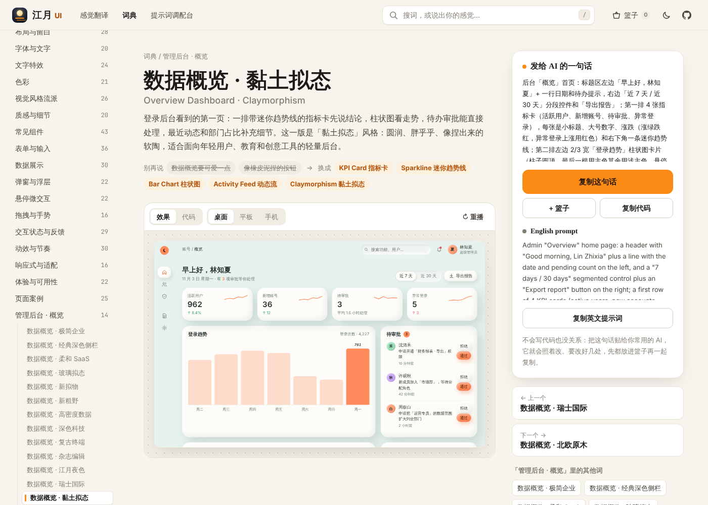

<p align="center"></p>

# 江月UI设计

> 给 AI 描述 UI，说对一个词就够了。

<p align="center">
  <a href="https://moonflower-king.github.io/-UI-/ui/"><b>🌙 打开「江月 UI」组件库 →</b></a>
  &nbsp;·&nbsp;
  <a href="https://moonflower-king.github.io/-UI-/ui/prompts.html">提示词调配台</a>
  &nbsp;·&nbsp;
  <a href="https://moonflower-king.github.io/-UI-/">UI 提示词图鉴</a>
</p>

<p align="center">
  <a href="https://moonflower-king.github.io/-UI-/ui/"></a>
</p>

不用安装，浏览器打开就能用：搜一个词或说出你想要的感觉，看实时效果，把提示词复制给 AI。

短视频系列「给AI描述UI的6个词」（江月AI设计）的工作仓库。每期讲一个 UI 主题里的 6 个专业术语，每个术语配一段实时动画和一段可以直接复制给 AI 的提示词。

这个仓库放三样东西：

| | 是什么 | 在哪 |
|---|---|---|
| 🧩 **开源 UI 词典** | 「UI 提示词图鉴」网站：每个术语都配实时动画、大白话解释和一键复制的提示词，可以搜索，零依赖 | [`图鉴网站（开源）/`](图鉴网站（开源）/) |
| 🎬 **视频素材库** | 每期一个文件夹：动画网页、横屏/竖屏视频、封面、小红书和抖音发布文案 | `EP01 …` ~ `EP12 …` |
| 🧱 **组件库** | 「江月 UI」词典：几百个术语和页面案例，每个都能实时预览、看代码、一键复制，还有感觉翻译器和提示词篮子 | [`组件库/`](组件库/) |
| 🛠️ **制作 skill** | 在 Claude Code 里说「做下一期」，就会按系列风格走完选题 → 动画 → 渲染 → 文案 → 上线 | [`.claude/skills/jiangyue-ui-video/`](.claude/skills/jiangyue-ui-video/SKILL.md) |

## 已发布

| 期 | 文件夹 | 6 个词 |
|---|---|---|
| 1 | [EP01 网页滚动动画](EP01%20网页滚动动画/) | Scroll-triggered · Scroll-linked · Parallax · Sticky · Scroll Snap · Horizontal Scroll |
| 2 | [EP02 鼠标悬停微交互](EP02%20鼠标悬停微交互/) | Magnetic Button · Spotlight Border · 3D Tilt · Morphing · Underline Slide · Image Zoom |
| 3 | [EP11 按钮点击反馈](EP11%20按钮点击反馈/) | Ripple Effect · Toggle Switch · Particle Burst · Hold to Confirm · Loading Button · Hamburger Toggle |
| 4 | [EP03 现代网页排版布局](EP03%20现代网页排版布局/) | Bento Grid · Masonry · Split Screen · Holy Grail · Asymmetrical Grid · Z-Pattern |
| 5 | [EP04 弹窗与浮层组件](EP04%20弹窗与浮层组件/) | Drawer · Bottom Sheet · Popover · Command Palette · Toast · Backdrop Modal |
| 6 | [EP05 加载与状态反馈](EP05%20加载与状态反馈/) | Skeleton Screen · Shimmer Effect · Progressive Blur · Optimistic UI · Stepper Progress · Pull to Refresh |
| 7 | [EP06 UI 视觉质感风格](EP06%20UI%20视觉质感风格/) | Glassmorphism · Neumorphism · Neo-Brutalism · Aurora Background · Bento Dark Mode · Layered Elevation |
| 8 | [EP12 动画缓动与节奏](EP12%20动画缓动与节奏/) | Ease-in-out · Spring · Stagger · Anticipation · Squash & Stretch · Motion Path |

下一期（已预告）：**第 9 期 · 页面转场**。排期和选题池见 [期数台账](.claude/skills/jiangyue-ui-video/references/期数台账.md)。

> EP 编号是制作编号，“第 N 期”是发布顺序，所以 EP11 是第 3 期。

## 每期包含

```
EPxx 主题/
  主题 动画网页.html          6 宫格纯 CSS 动画（打开即可预览，URL 加 #portrait 看竖屏版）
  主题（横屏 16比10）.mp4      1920×1200 · 60fps · 12s
  主题（竖屏 9比16）.mp4       1080×1920 · 60fps · 12s
  主题 封面（横屏/竖屏）.png
  主题 发布文案.md            小红书标题、正文、关键词、置顶评论、6 段 Prompt
  主题 抖音发布包.md          抖音标题、描述、搜索词、发布设置
```

## 常用命令

需要 Node.js 18+ 和 ffmpeg。首次使用：

```bash
npm run setup
```

```bash
npm run check -- "EP11 按钮点击反馈"
```

```bash
npm run render -- "EP11 按钮点击反馈/按钮点击反馈 动画网页.html"
```

```bash
npm run build
```

- `check`：发片前自检，包括外壳是否被改、6 个词的顺序、标题字数、Prompt 格式
- `render`：逐帧渲染横屏/竖屏 MP4 和封面（加 `--cover-only` 只出封面）
- `build`：生成组件库和图鉴网站的数据（等于先 `build:ui` 再 `build:site`）。生成的文件不入库，本地预览前跑一次；线上由 GitHub Actions 自动生成
- `build:site`：从各期 `EPxx 主题/` 文件夹生成图鉴网站数据
- `build:ui`：从 `组件库/components/` 生成组件库数据

## 在线访问

- 组件库：<https://moonflower-king.github.io/-UI-/ui/>
- 提示词调配台：<https://moonflower-king.github.io/-UI-/ui/prompts.html>
- 图鉴网站：<https://moonflower-king.github.io/-UI-/>

仓库已带 GitHub Pages 自动部署（[`.github/workflows/pages.yml`](.github/workflows/pages.yml)）。在 **Settings → Pages → Source** 里选择 **GitHub Actions**，之后每次合并到 `main` 都会自动构建并发布；提 PR 时会先跑一遍构建检查，有错会在合并前报红。

## 许可

图鉴网站代码使用 [MIT](图鉴网站（开源）/LICENSE) 许可。视频、封面、文案版权归 江月AI设计 所有。
